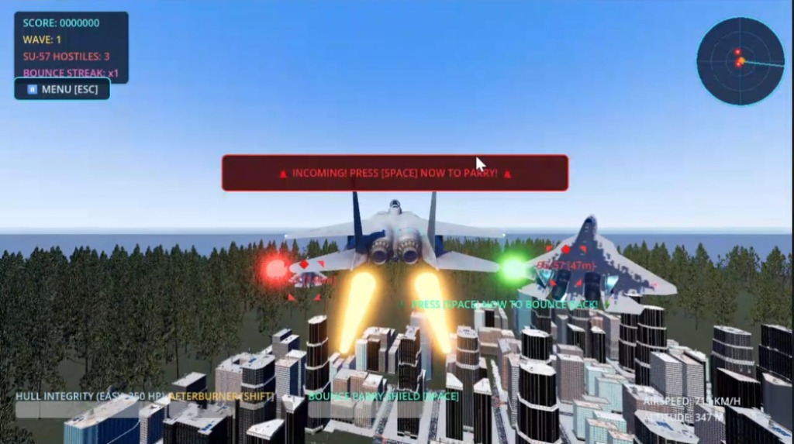
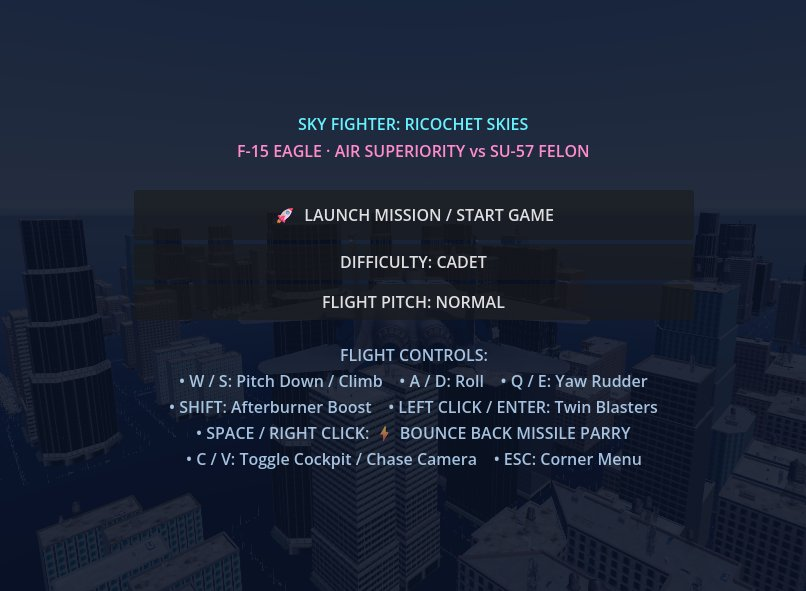
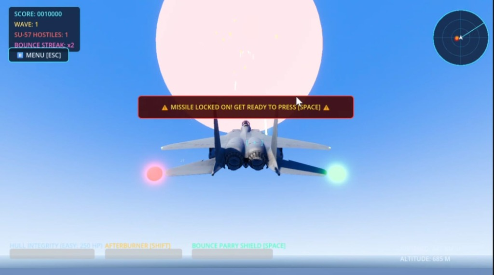
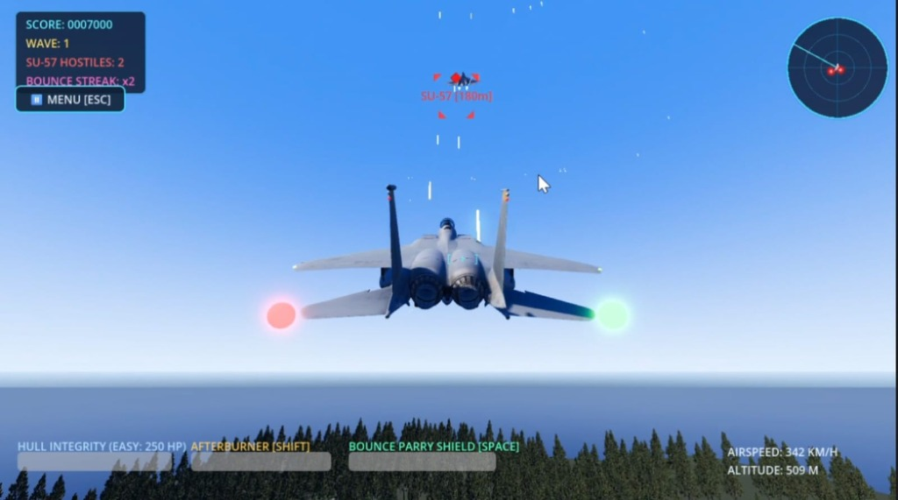
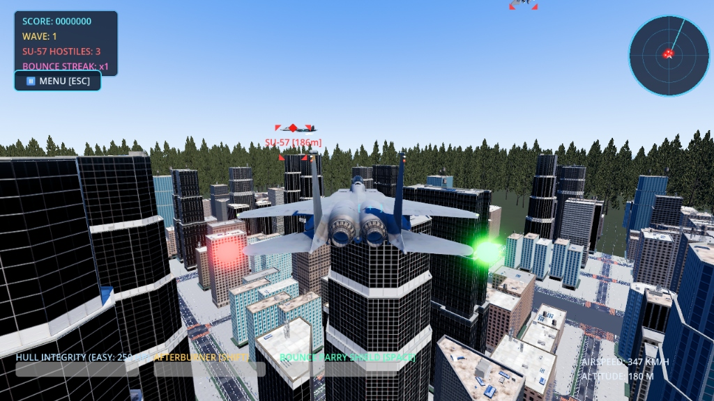
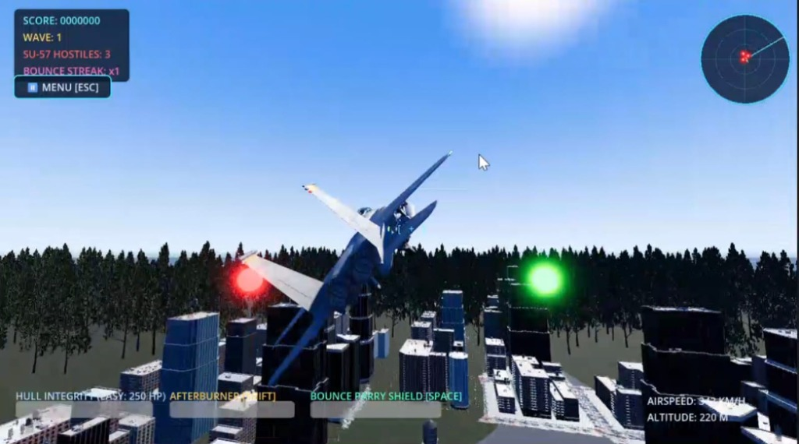
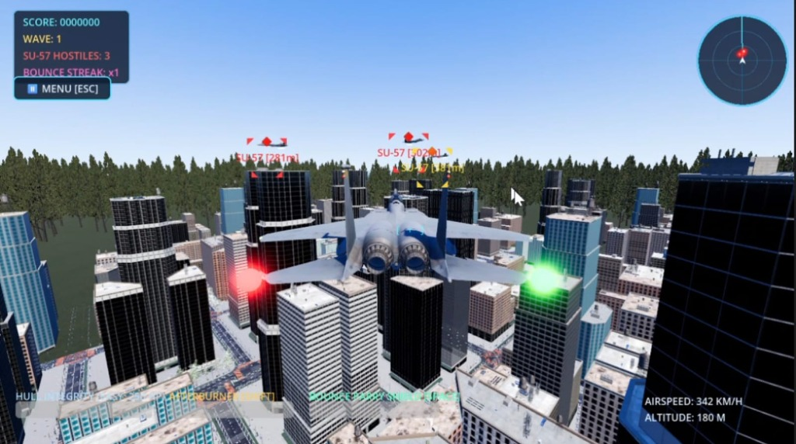
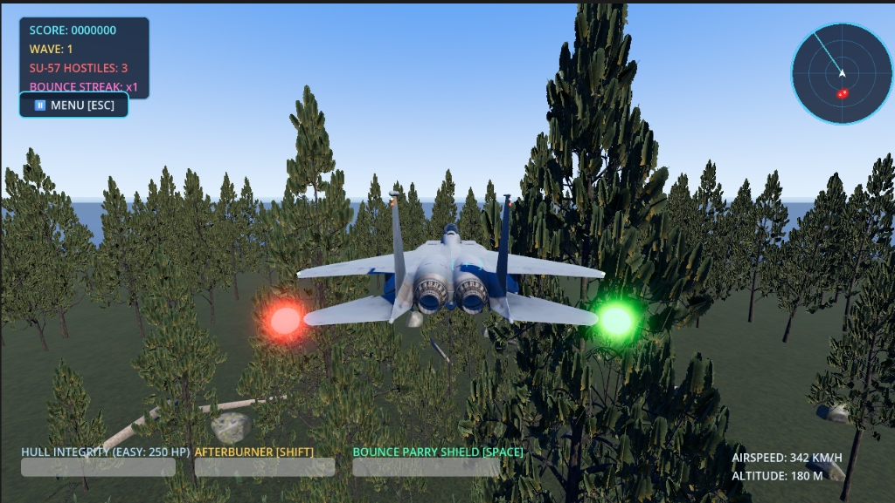
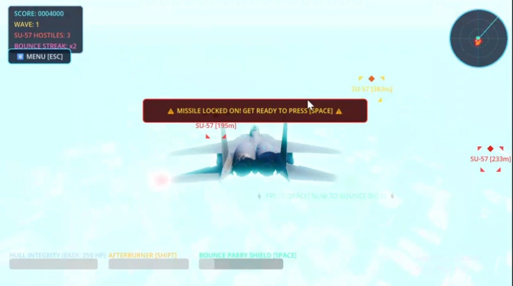

# ✈️ Sky Fighter: Ricochet Skies

<p align="center">
  
</p>

<p align="center">
  <b>High-speed 3D arcade flight combat simulator built with Godot 4.3+</b><br>
  Engage hostile Su-57 stealth fighters, execute high-G evasive maneuvers through skyscraper canyons, and turn enemy weapons against them with the signature <b>Ricochet Missile Parry</b>!
</p>

<p align="center">
  <a href="https://sky-fighter-ricochet.vercel.app"><b>🎮 PLAY LIVE DEMO</b></a> •
  <a href="https://github.com/gpreethish08/sky-fighter-ricochet"><b>GitHub Repository</b></a>
</p>

<p align="center">
  <a href="https://sky-fighter-ricochet.vercel.app"></a>
  <a href="https://github.com/gpreethish08/sky-fighter-ricochet/stargazers"></a>
  <a href="https://github.com/gpreethish08/sky-fighter-ricochet/network/members"></a>
  <a href="https://github.com/gpreethish08/sky-fighter-ricochet/blob/main/LICENSE"></a>
  <a href="https://godotengine.org/"></a>
</p>

---

## 📸 In-Game Screenshots

### 🎮 Mission Briefing & Title Menu
<p align="center">
  
</p>

### 💥 Combat & The Ricochet Parry System
When enemy Su-57s lock onto your F-15, a high-priority HUD alert sounds. Time your parry with `[SPACE]` to deflect enemy heat-seeking missiles straight back at the hostile jet!

| 🚨 Missile Lock Warning & Parry Timing | 🎯 Target Diamond & Lead Pursuit |
| :---: | :---: |
|  |  |
| *Real-time lock-on countdown with audio alarm* | *High-visibility HUD brackets with rangefinder* |

---

### 🏙️ Skyscraper Canyons & Aerial Dogfights
Weave between glass skyscrapers and bank across coastal city terrain with responsive flight controls and coordinated wing tilt.

| 🏢 Low-Altitude Urban Run | ⚡ High-G Banking & Roll |
| :---: | :---: |
|  |  |
| *High-speed low-altitude canyon run* | *Smooth banking and aerodynamic wing tilt* |

| 🌆 Weaving Through Skyscraper Towers | 🌲 Pine Forest Mountain Valley |
| :---: | :---: |
|  |  |
| *Multiple Su-57s swarming the city grid* | *Natural mountain perimeter with dense pine canopy* |

### ☁️ Cloud Ceiling Dogfight
<p align="center">
  
</p>

---

## 🎮 Key Features

- **Iconic Jet Fighters**:
  - **Player**: F-15 Eagle with coordinated banking, afterburners, wingtip navigation lights, and twin blasters.
  - **Hostiles**: Su-57 Felon stealth fighters with AI flight patterns, missile locks, and evasive routines.
- **Dynamic Ricochet Parry Mechanic**:
  - Lock-on alert warns when an enemy missile is bearing down on you.
  - Pressing `[SPACE]` activates the Ricochet Shield, reflecting incoming missiles back to destroy the attacker with bonus streak multipliers.
- **Detailed 3D Battle Arena**:
  - Multi-tile coastal city with skyscraper canyons.
  - Surrounding pine forest mountain perimeter and boundless ocean.
- **Arcade Combat HUD**:
  - Tactical 360° circular mini-radar displaying player orientation and enemy positions.
  - HUD diamond target brackets showing range and azimuth to bogies.
  - Real-time Hull Integrity, Afterburner Boost, and Parry Shield cooldown meters.
- **Dynamic Sound Effects**:
  - Jet engine roar, afterburner ignition, cannon fire, lock-on alarms, parry sonic booms, and explosive impacts.

---

## 🕹️ Controls

| Action | Primary Key | Secondary Key |
| :--- | :--- | :--- |
| **Pitch Down / Up (Climb / Dive)** | `W` / `S` | `Down` / `Up` Arrow |
| **Roll & Turn Left / Right** | `A` / `D` | `Left` / `Right` Arrow |
| **Afterburner Boost** | `Shift` | - |
| **Air Brake / Slow** | `Ctrl` | - |
| **Twin Blasters (Fire)** | `F` | Left Mouse Click |
| **Ricochet Missile Parry** | `Spacebar` | Right Mouse Click |
| **Yaw Rudder** | `Q` / `E` | - |
| **Camera Toggle (Cockpit / Chase)** | `C` / `V` | - |
| **Pause / Menu** | `Escape` | - |

---

## 🚀 Getting Started

### Prerequisites

- [Godot Engine 4.x](https://godotengine.org/download) (Standard 64-bit)
- [Git LFS](https://git-lfs.github.com/) (Required for cloning 3D model assets)

### Cloning with Git LFS

Make sure Git LFS is installed before cloning to pull all 3D assets:

```bash
# 1. Initialize Git LFS
git lfs install

# 2. Clone repository
git clone https://github.com/gpreethish08/sky-fighter-ricochet.git
cd sky-fighter-ricochet
```

### Running in Godot Engine

1. Open Godot Engine.
2. Click **Import** and select `godot_flight_game/project.godot`.
3. Press **F5** (or click the Play icon in the top right) to launch!

### Running the Web Version

You can test the game directly in any modern WebGL browser:
- Open [`index.html`](index.html) or [`flight.html`](flight.html) locally in your browser.
- Or deploy directly to [Vercel](https://vercel.com/new/clone?repository-url=https://github.com/gpreethish08/sky-fighter-ricochet) or GitHub Pages!

---

## 📁 Repository Structure

```text
├── godot_flight_game/          # Godot 4 project directory
│   ├── asserts/                # 3D models (GLB), textures, and materials
│   ├── audio/                  # Combat and UI sound effects (.wav)
│   ├── scenes/                 # Main game & player scenes (.tscn)
│   ├── scripts/                # GDScript logic (flight, radar, AI, HUD)
│   ├── export_presets.cfg      # Godot build presets
│   └── project.godot           # Godot project configuration
├── screenshots/                # In-game gameplay & combat screenshots
├── index.html                  # Playable web build for instant deployment
├── flight.html                 # Standalone browser/WebGL flight game
├── vercel.json                 # Vercel deployment routing configuration
├── .gitattributes              # Git LFS tracking rules for 3D assets
├── .gitignore                  # Clean Godot & build ignores
└── README.md                   # Project documentation & visual gallery
```

---

## 📜 License

This project is licensed under the MIT License.
